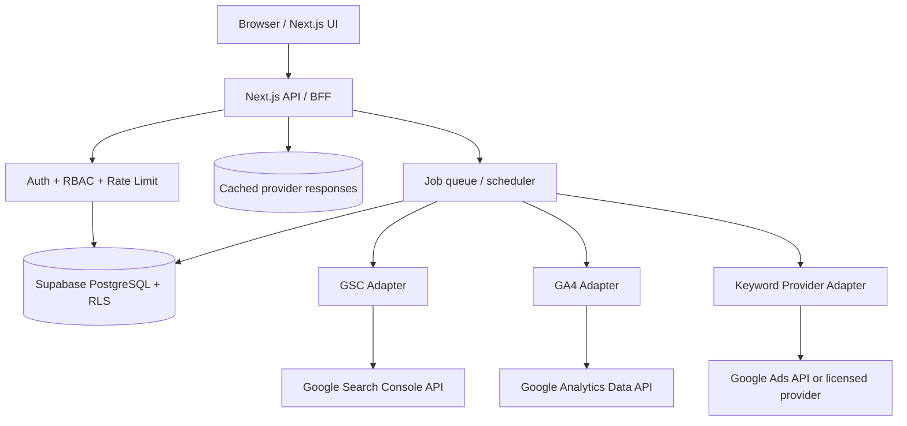

# PRODUCT REQUIREMENTS DOCUMENT (PRD)

# KeywordScope — Keyword Research & SEO Monitoring

**Version:** 1.0  
**Date:** 14 November 2026  
**Platform:** Responsive web dashboard (desktop-first, mobile-friendly)  
**Status:** Proposed / ready for technical planning  
**Product type:** Multi-tenant SaaS  
**Primary language:** Indonesian; English-ready (i18n)

---

## 1. Executive Summary

KeywordScope is a web application that combines (1) keyword discovery and research for Google Search and (2) SEO performance monitoring for Google Search Console (GSC) and Google Analytics 4 (GA4). Users can analyze target keywords by country and language, connect properties they are authorized to access, identify growth opportunities, track changes, and export reports. Research and monitoring remain distinct workflows because their data sources, metrics, and access controls differ.

**Value proposition:** Make keyword research and organic search reporting accessible through a single streamlined dashboard, initially targeted at Indonesian website owners, SEO freelancers, developers, UMKM, and small digital agencies.

**Product principles:** accurate provenance, no invented metrics, transparent data freshness, privacy by default, predictable cost, mobile-friendly, gradual provider integration.

## 2. Problem Statement

- Keyword planning, ranking analysis, Search Console and GA4 reporting are fragmented across tools.
- Small teams struggle to distinguish advertising competition from organic SEO difficulty.
- SEO performance metrics do not automatically tell users what to optimize next.
- Access to official keyword planning metrics and SERP services varies by account, API permissions and budget.
- Manual reporting for multiple websites is time-consuming.

## 3. Goals, Non-goals and Success Criteria

### 3.1 Goals

G1. Support secure Google account sign-in and read-only connection of authorized GSC/GA4 properties.
G2. Show clicks, impressions, CTR, average position, trending queries, top pages and filters.
G3. Provide a keyword research workspace with seed keyword, language, location, intent labels and provider-supplied metrics where available.
G4. Save keyword lists, associate keywords with projects, and highlight opportunities with transparent rules.
G5. Allow users to export reliable, labeled reports.
G6. Support multiple projects with strict data isolation.

### 3.2 Non-goals in MVP

- Guaranteeing any keyword's Google ranking.
- Showing real-time Google rankings from GSC (GSC reports average position, often delayed).
- Providing organic search query terms from GA4 alone.
- Claiming Google Ads competition index is organic keyword difficulty.
- Unlimited SERP scraping or bypassing search engine restrictions.
- Automated content publication, backlink building, AI content generation, billing and white-label reports.

### 3.3 Proposed product KPIs (targets, not actuals)

- > = 80% of testers who begin GSC authorization successfully connect a property.
- > = 90% successful scheduled synchronization jobs, excluding upstream outages/expired permission.
- > = 95% dashboard requests served from cache under 3 seconds at p95 for typical projects.
- > = 30% of activated testers save a keyword or create an opportunity list within 7 days.
- Zero known cross-tenant data exposure, zero raw OAuth tokens sent to the browser.

## 4. Personas

| Persona              | Primary task                         | Need                                                  |
| -------------------- | ------------------------------------ | ----------------------------------------------------- |
| Website owner / UMKM | Discover what customers search for   | Clear keyword ideas and opportunity scores            |
| SEO freelancer       | Analyze several client websites      | Multi-project filtering, comparisons, export          |
| Frontend developer   | Validate SEO impact after deployment | GSC queries, landing pages and technical next actions |
| Small agency         | Report organic progress              | Repeatable monitoring and project separation          |

## 5. Information Architecture

Primary sidebar navigation:

1. Overview
2. Keyword Explorer
3. Keyword Lists
4. SEO Monitoring (Search Performance, Queries, Pages, Opportunities)
5. Analytics (GA4 Traffic & Engagement)
6. Reports / Export
7. Projects & Connections
8. Settings / Account

Top bar: active project selector, date range picker, country/device filters where relevant, sync status, user menu.

Empty states: Connect Google / Add first project / Run first research. Each widget displays its provider, metric definition, period and latest successful sync.

## 6. User Stories and Acceptance Criteria

### US-01 Sign in / create workspace — P0

As a new user, I can sign in with Google or email so that my workspace is private.

- Successful sign-in creates user and default workspace.
- Unauthenticated users cannot access protected routes.
- User sees clearly separated 'Sign in' and 'Connect Google data' permissions.
- Session renewal and sign-out function properly.

### US-02 Manage projects — P0

As a user, I can add a named project and associate a website with it.

- Project fields: name, URL/domain, default country, language, timezone.
- Multiple projects are supported; duplicate domain may exist across separate workspaces.
- Every project read/write operation verifies membership and role.

### US-03 Connect Search Console — P0

As a user, I can connect only GSC properties for which I have access.

- Read-only OAuth scope `https://www.googleapis.com/auth/webmasters.readonly`.
- Return available properties and access levels; user selects one.
- Handle revoked access, expired tokens, empty properties and API errors.
- Disconnect stops further synchronization and revokes tokens where feasible.

### US-04 View SEO overview — P0

As a user, I can see organic search performance by date.

- Cards: clicks, impressions, CTR, weighted average position.
- Line chart by date, period comparison and top queries/pages.
- Filters: GSC search type, country, device, date; use only compatible filters.
- All views label timezone, data freshness and incomplete periods.
- No-data states distinguish no traffic from sync failure.

### US-05 Query performance — P0

As a user, I can inspect search queries driving impressions and clicks.

- Sort/filter/search query list.
- Fields: query, clicks, impressions, CTR, average position; optional comparison deltas.
- Query click opens related pages with appropriate GSC filters.
- Downloads export the filtered dataset and carry a source/freshness note.
- Display GSC data limitations; API may not return all rows.

### US-06 Keyword research — P0 (provider-dependent)

As a user, I can submit seed keywords and find related ideas.

- Inputs: keyword(s), location, language, optional site URL.
- Results: keyword, estimated average monthly searches if available, monthly trend if available, advertising competition index if available, bid ranges if available, source and date.
- Provider status: live / cached / unavailable / mock (development only).
- If no authorized keyword data provider exists, clearly explain unavailability rather than fabricate metrics.
- Prevent unchecked expensive calls: quotas, throttling, input limits, caching.

### US-07 Save research keywords — P0

As a user, I can save and organize ideas.

- Create, rename, delete keyword lists; add/remove keywords; prevent duplicates per list under canonical normalization.
- Save metadata: targeting, source, snapshot date, optional note.
- Import/export UTF-8 CSV with validation and per-row error handling.

### US-08 SEO opportunity detection — P1

As a user, I can see which search queries or pages are candidates for optimization.

- High impressions + low CTR rule based on a configurable minimum threshold.
- Near-first-page candidate using average position range configurable (example 5–15), explicitly not actual live rank.
- Rising/falling query using 28-day vs prior 28-day comparative data.
- Each recommendation shows rule, underlying data, uncertainty and action suggestion.

### US-09 Connect GA4 — P1

As a user, I can connect an authorized GA4 property.

- OAuth `https://www.googleapis.com/auth/analytics.readonly`; list/select authorized property where supported.
- Reporting: organic-search sessions, users, engagement, conversions/key events (subject to actual metric support and property configuration).
- GA4 data stays separately identified from GSC data; avoid falsely asserting precise 1:1 matching of queries to sessions/conversions.
- GA4 absence does not block GSC functionality.

### US-10 Reporting/export — P1

As a user, I can export a period summary.

- CSV export in MVP; PDF and scheduled email later.
- Export includes project, source, filters, requested window, generated timestamp, freshness statement.
- Async export for large datasets; rate and size limits.

### US-11 Background sync — P0

As a user, my monitoring metrics refresh regularly.

- Initial backfill, then scheduled daily sync of finalized data.
- Idempotent upserts; retry exponential backoff on transient failure.
- Retain last-success and last-error states.
- Refresh token operations occur server side only.

### US-12 Roles and privacy — P0

As a workspace owner, I control membership and access.

- MVP role: owner/member; later admin/analyst/viewer.
- Row-level policies enforce workspace isolation, including exports, jobs and cached data.
- Owner can request disconnect/deletion of project data.

## 7. Detailed Feature Requirements

### 7.1 Overview dashboard

KPI tiles (GSC only): total clicks, total impressions, CTR = clicks/impressions, aggregate position computed with appropriate impression weighting; daily visualization, top queries, top pages, change versus comparable preceding period. Include filter badges only for active filters. Freshness label: 'last synced at ...' and if preliminary data is included.

### 7.2 Keyword Explorer

Inputs: seed keyword(s), target region (default Indonesia), language (default Indonesian), max idea count, optional URL seed. Results support sorting by volume, competition and keyword name and filters for search-intent labels. Intent categories (informational, navigational, commercial, transactional) are heuristic classifications, not Google-provided metrics; label them accordingly. 'SEO Difficulty' is **not** shown in MVP absent a documented methodology and SERP data.

### 7.3 Project and monitoring detail

Tabs: Performance, Queries, Pages, Devices, Countries, Opportunities, GA4. Preserve same date filters where supported. Comparison deltas show both absolute and percentage, with zero-baseline handling. Average position is descriptive, never labeled as 'live SERP rank'.

### 7.4 Saved keywords

Lists belong to workspace/project. Targeting is part of each keyword's context. Changes to provider data do not silently overwrite saved historic snapshots. Keyword suggestions can be assigned to content planning tasks in a future phase.

### 7.5 Search / rank tracking boundaries

GSC average position: from verified website property, historical, aggregated; included in MVP.
SERP actual rankings for arbitrary sites/locations: require separate legitimate SERP data provider, varying availability/cost; later phase. The product must not imply that checking Google Search directly returns stable or universal rankings.

## 8. External APIs & Access Policy

| Provider                              | Purpose                                                                         | Authentication                                 | Availability / caveat                                                           |
| ------------------------------------- | ------------------------------------------------------------------------------- | ---------------------------------------------- | ------------------------------------------------------------------------------- |
| Google Search Console API             | Authorized site's query/page performance, property listing                      | Google OAuth read-only                         | P0, best initial integration; top rows and data limits apply                    |
| Google Analytics Data API (GA4)       | Organic channel traffic, engagement and key events                              | OAuth analytics.readonly                       | P1; no full organic search keyword list from GA4                                |
| Google Ads API KeywordPlanIdeaService | Keyword ideas, historical monthly search volume, ad competition and bid metrics | Google OAuth + approved Ads API project access | **Basic/Standard access needed for planning methods**, approval is a dependency |
| Google Trends API                     | Interest trend over time                                                        | API-access application                         | Alpha limited access as documented; not a P0 dependency                         |
| Licensed SERP API                     | SERP listings, rank tracking and competitive landscape                          | Provider API key                               | Optional P2; confirm legal terms, quality, costs and locale coverage            |

**Important November 2026 policy update:** Google Ads developer tokens were sunset on 9 September 2026; API onboarding/access levels are managed through Google Cloud projects. Enabling API yields Test access, Explorer can query production but restricts planning methods, and Basic or Standard is required to use `KeywordPlanIdeaService`. Do not implement an outdated 'get developer token' onboarding step as a required new-user prerequisite.

**Data provenance and language requirements:**

- Mark GSC 'average position', Google Ads 'advertising competition', and provider-produced 'SEO difficulty' as distinct.
- Mark volume 'estimated average monthly searches', not guaranteed exact demand.
- Treat Google Trends interest as a trend series, not search-volume counts.
- Display null/insufficient data explicitly; never replace with 0 unless response actually says 0.
- Different provider numbers may use different coverage and must not be directly summed.
- Make user-facing explanation of Google API service permissions, data sharing and external-provider terms.

## 9. Backend Architecture

### 9.1 Architecture diagram



### 9.2 Recommended stack

- Frontend: Next.js App Router, TypeScript, Tailwind CSS, shadcn/ui, TanStack Query, Recharts.
- Server: Next.js route handlers/BFF and isolated service modules; split to separate Node worker when scale demands.
- Auth: Supabase Auth, with Google sign-in and separately managed Google API OAuth consent.
- DB: Supabase PostgreSQL, migrations and RLS.
- ORM/query: Drizzle ORM or Supabase typed client (choose one convention; recommended Drizzle for server business logic).
- Validation: Zod; server is source of truth.
- Scheduled tasks: protected cron endpoint or managed queue/worker (not a browser timer).
- Observability: structured JSON logs, error monitoring, job attempt records and provider latency.
- Deployment: Vercel for frontend/API; Supabase for database; managed worker/job scheduling if limits require it.

### 9.3 Service boundaries

`AuthService`: users, sessions and OAuth authorization.
`ProjectService`: workspaces, members, projects and permission checks.
`GscService`: sites listing, analytics queries, normalized GSC aggregates.
`Ga4Service`: property association and report acquisition.
`KeywordProvider`: `getIdeas(params)` and `getHistoricalMetrics(params)` interface.
`KeywordService`: saved lists, normalization, metadata.
`OpportunityService`: documented rule-based scoring with reproducible inputs.
`SyncService`: scheduling, retries, storage and status.
`ReportService`: CSV generation and export access.

### 9.4 Provider interface

```ts
export interface KeywordProvider {
  id: string;
  getIdeas(input: {
    seeds: string[];
    countryCode: string;
    languageCode: string;
    limit: number;
  }): Promise<KeywordIdea[]>;
  getHistoricalMetrics(input: {
    keywords: string[];
    countryCode: string;
    languageCode: string;
  }): Promise<KeywordMetric[]>;
}

export interface KeywordMetric {
  keyword: string;
  avgMonthlySearches: number | null;
  advertisingCompetitionIndex: number | null;
  bidLowMicros: number | null;
  bidHighMicros: number | null;
  currencyCode: string | null;
  collectedAt: string;
  source: string;
  status: "live" | "cached" | "unavailable" | "mock";
}
```

Mock data is permitted in local/demo environments only and must have an unmistakable demo label.

## 10. Database Design

All mutable business rows have UUID primary key, created_at and updated_at. Multi-tenant tables include workspace_id and server-verified authorization, with PostgreSQL RLS on client-exposed relations.

| Table                      | Key fields                                                                                                                                                    | Purpose                               |
| -------------------------- | ------------------------------------------------------------------------------------------------------------------------------------------------------------- | ------------------------------------- |
| users                      | id, email, display_name                                                                                                                                       | Platform users (references auth user) |
| workspaces                 | id, name, owner_user_id                                                                                                                                       | Tenant/account boundary               |
| workspace_members          | workspace_id, user_id, role                                                                                                                                   | Membership / access                   |
| projects                   | id, workspace_id, name, domain, default_country, default_language, timezone                                                                                   | Websites and research contexts        |
| oauth_connections          | id, workspace_id, user_id, provider, encrypted_refresh_token_ref, scopes, status, expires_at                                                                  | Server-side provider credentials      |
| project_properties         | id, project_id, provider, property_id, display_name, connection_id                                                                                            | Mapped GSC/GA4 property identifiers   |
| keyword_lists              | id, workspace_id, project_id, name                                                                                                                            | Saved research lists                  |
| keywords                   | id, canonical_text, display_text, language_code                                                                                                               | Normalized keyword dictionary         |
| keyword_list_items         | list_id, keyword_id, country_code, notes, added_at                                                                                                            | List membership / locale              |
| keyword_metric_snapshots   | id, keyword_id, country_code, language_code, provider, avg_monthly_searches, ad_competition_index, bid_low_micros, bid_high_micros, currency_code, fetched_at | External research metrics             |
| gsc_daily_property_metrics | project_id, property_id, date, search_type, country, device, clicks, impressions, position_weighted_sum                                                       | Daily totals at explicit grain        |
| gsc_query_daily            | project_id, property_id, date, search_type, query_text, country, device, clicks, impressions, position_weighted_sum                                           | Query-grain GSC rows                  |
| gsc_page_daily             | project_id, property_id, date, search_type, page_url, country, device, clicks, impressions, position_weighted_sum                                             | Page-grain GSC rows                   |
| ga4_daily_channel_metrics  | project_id, property_id, date, channel_group, sessions, active_users, engagement_rate, key_events                                                             | GA4 channel metrics                   |
| sync_jobs                  | id, project_id, provider, period_start, period_end, status, attempts, started_at, completed_at, error_code                                                    | Observability and retries             |
| exports                    | id, workspace_id, project_id, requested_by, format, status, file_path, expires_at                                                                             | Export lifecycle                      |
| audit_events               | id, workspace_id, user_id, action, entity_type, entity_id, created_at                                                                                         | Audit logging                         |

**Critical measurement design:** Never sum GSC query-grain rows and treat them as guaranteed exhaustive sitewide totals. Fetch site/property totals separately. GSC data is subject to privacy and top-row limits. For aggregating average position, store appropriate impression-weighted numerator and denominator and avoid blindly averaging daily average-position values. Explicitly define dimensions/grains and uniqueness constraints for each aggregate.

Suggested indexes: `(workspace_id, created_at)`, `(project_id, date DESC)`, `(project_id, query_text, date DESC)`, `(keyword_id, country_code, language_code, provider, fetched_at DESC)`. Unique constraints by provider property and measurement grain. Retention policy specified before production release.

## 11. Internal REST API Contract (v1)

Base path `/api/v1`; all endpoints use session authentication, workspace permission checks and JSON error shape `{ code, message, requestId }`. Use cursor pagination when lists become large.

| Method   | Endpoint                                       | Action                                                  |
| -------- | ---------------------------------------------- | ------------------------------------------------------- |
| GET      | `/workspaces`                                  | List accessible workspaces                              |
| POST     | `/projects`                                    | Create project                                          |
| GET      | `/projects/:projectId`                         | Project detail                                          |
| PATCH    | `/projects/:projectId`                         | Update project                                          |
| DELETE   | `/projects/:projectId`                         | Delete/archive project                                  |
| GET      | `/integrations/google/start?provider=gsc`      | Start OAuth with CSRF state                             |
| GET      | `/integrations/google/callback`                | Verify state + store authorized credential              |
| GET      | `/integrations/google/properties?provider=gsc` | List authorized properties                              |
| POST     | `/projects/:projectId/properties`              | Bind selected property                                  |
| DELETE   | `/integrations/:connectionId`                  | Disconnect/revoke integration                           |
| GET      | `/projects/:projectId/overview`                | Summary KPIs + period comparison                        |
| GET      | `/projects/:projectId/gsc/queries`             | Paginated query performance                             |
| GET      | `/projects/:projectId/gsc/pages`               | Page performance                                        |
| GET      | `/projects/:projectId/ga4/overview`            | GA4 organic channel overview                            |
| POST     | `/keywords/research`                           | Run a provider-bound keyword research request           |
| GET      | `/keywords/research/:requestId`                | Check queued result/status                              |
| GET/POST | `/projects/:projectId/keyword-lists`           | List/create keyword lists                               |
| POST     | `/keyword-lists/:listId/items`                 | Save keywords                                           |
| DELETE   | `/keyword-lists/:listId/items/:itemId`         | Remove list item                                        |
| GET      | `/projects/:projectId/opportunities`           | Rule-based opportunities                                |
| POST     | `/projects/:projectId/exports`                 | Start export                                            |
| GET      | `/exports/:exportId`                           | Check progress / signed URL                             |
| POST     | `/internal/sync/run`                           | Protected scheduler trigger, not public client endpoint |

**Sample request:**

```json
{
  "seeds": ["jasa pemasangan cctv"],
  "countryCode": "ID",
  "languageCode": "id",
  "limit": 50,
  "projectId": "uuid-of-project"
}
```

**Sample response shape (illustrative schema, not actual results):**

```json
{
  "status": "completed",
  "source": "google_ads",
  "fetchedAt": "2026-11-14T00:00:00Z",
  "items": [
    {
      "keyword": "jasa pemasangan cctv",
      "avgMonthlySearches": null,
      "advertisingCompetitionIndex": null,
      "seoDifficulty": null,
      "dataStatus": "unavailable"
    }
  ]
}
```

## 12. Data Synchronization and Freshness

- On first GSC connection, request an initial historical window within permitted API/retention constraints; use date partitions and paginated requests.
- Schedule daily sync for finalized dates and re-fetch recent days as needed for corrections/late data.
- Fetch overview/property aggregate separately from query and page breakdown.
- GSC Search Analytics requests can fetch max 25,000 rows per call via pagination; upstream retrieval is not guaranteed exhaustive and has a practical per-day/per-search-type limit.
- GA4 Core report requests are subject to property/project quotas; cache and batch where suitable.
- Keyword planning metrics typically update monthly; use cache and a longer TTL rather than constant re-fetches.
- Each job is idempotent via unique keys/upsert, records attempts, distinguishes 401/403 from 429/5xx, and surfaces last successful sync.
- Never promise real-time data when provider cannot provide it.

## 13. Opportunity Rules v1

Rules are explainable, optional and configurable per project:

1. **High-impression/low-CTR:** impressions >= threshold AND CTR below project baseline or comparable query/page cohort. Do not assume low CTR always means a problem; review SERP intent and rank.
2. **Near-top candidate:** avg position within e.g. 5–15 and sufficient impressions; label as approximate historical position.
3. **Declining clicks:** previous 28 days vs current 28 days shows meaningful drop after considering data completeness.
4. **High impression/no clicks:** high visibility but 0 clicks; suggest title/meta review only as a hypothesis.
5. **Growing query:** significant recent rise in impressions or clicks; suggest content expansion.

All cards provide source, threshold, date range, underlying metric values and a human-readable explanation. No guarantee of outcome.

## 14. UX/UI Design Requirements

- Desktop-first 1440px with 12-column responsive grid; support 1280px, 1024px, 768px and 375px.
- Persistent left sidebar on desktop; drawer/navigation pattern on mobile.
- Visual style: modern analytics SaaS, clear typography (Inter or Geist), neutral backgrounds, one primary accent, accessible chart contrast.
- Design tokens should cover color, typography, spacing, radius, shadows and semantic status colors.
- Screens: Login, Onboarding, Project Overview, Keyword Explorer, Research Results, Keyword Lists, GSC Performance, Queries, Pages, Opportunities, GA4 Analytics, Integrations, Settings, Export History.
- Loading skeletons, retry states, empty states, permissions states, API limit errors, and success feedback.
- Every performance chart must show period and units; tables support sorting, pagination and keyboard focus.
- Accessible input labels, WCAG 2.2 AA target, readable tooltips and reduced-motion support.
- Avoid decorative stats on production pages unless sourced from real data.

## 15. Security, Privacy and Compliance

- Use authorization code OAuth flow with PKCE and state validation where applicable.
- Ask for minimum necessary scopes; use read-only GSC/GA4 scopes.
- Separate identity sign-in from consent to access customer analytics.
- Encrypt refresh tokens at rest; keep access and refresh tokens server-only; redact tokens from logs and monitoring.
- Rotation/revocation supported; secure session cookie settings, CSRF defenses, HTTPS enforced.
- Server-side authorization on every endpoint; RLS on exposed tenant tables; non-public exports use expiring signed URLs.
- Provider API keys and secret values live in managed secrets, never `NEXT_PUBLIC_*`.
- Rate limits, per-user usage budgets, per-workspace quotas, retry/backoff, and anti-abuse controls.
- Provide privacy policy, deletion/disconnect workflows, audit logs and transparent retention period; review Google API policy and applicable data protection law before launch.
- Never automatically expose another site's Search Console/GA4 data without ownership or authorization.

## 16. Nonfunctional Requirements

| Area          | Target                                                                             |
| ------------- | ---------------------------------------------------------------------------------- |
| Performance   | Cached dashboard p95 < 3 seconds under agreed load test                            |
| Availability  | 99.5% target after production stabilization (not an SLA until measured)            |
| Freshness     | Daily sync with explicit timestamps and lag indication                             |
| Reliability   | Idempotent jobs, exponential retry and dead-letter/manual retry after max attempts |
| Scalability   | Modular adapters, indexed DB queries, caching, background workers                  |
| Accessibility | Target WCAG 2.2 AA                                                                 |
| Localization  | Indonesian initially; English labels and `Intl`-based number/date formatting ready |
| Observability | Metrics for API errors, queue depth, provider failures, sync lag, export failures  |
| Testability   | Unit, integration, API contract, permission, OAuth and E2E testing                 |

## 17. MVP Definition and Priorities

### MVP Core (must ship)

- User login and private workspaces.
- Project creation and project switcher.
- GSC read-only OAuth and verified property connection.
- Initial backfill and scheduled daily sync.
- Overview performance graphs and top queries/pages.
- Filtering by date/device/country with consistent metric calculations.
- Keyword Explorer UI, normalized provider interface and clear no-provider state.
- Saved keyword lists, notes, CSV export/import.
- Sync status, API error handling and data provenance.
- Permission tests, secret handling, observability and security basics.

### MVP+ (after core stabilization)

- Production keyword idea and volume provider once access approved.
- GA4 property connection and organic traffic dashboard.
- Rule-based SEO opportunities and period comparisons.
- Exportable client summary.

### Later

- Localized SERP ranking and competitors using licensed provider.
- Advanced clustering and content gap detection.
- Scheduled reports, alerts, team permissions, billing, white-label, AI recommendations.

## 18. Roadmap (planning estimates, not guaranteed delivery)

| Phase   | Milestone                 | Deliverables                                                                         | Exit gate                                                              |
| ------- | ------------------------- | ------------------------------------------------------------------------------------ | ---------------------------------------------------------------------- |
| Phase 0 | Research & access         | Validate Ads access route, confirm GSC/GA4 accounts, prototype API calls, cost model | One real GSC property successfully read                                |
| Phase 1 | Foundation                | Next.js app, auth, DB/RLS, projects, UI shell                                        | Auth + project management E2E pass                                     |
| Phase 2 | GSC core                  | OAuth, sync jobs, normalized GSC stores, dashboard, queries/pages                    | Metrics reconcile within known provider limitations                    |
| Phase 3 | Research workspace        | Keyword Explorer, provider adapters, lists, CSV, provider status                     | Real provider works if approved; otherwise feature transparently gated |
| Phase 4 | Analytics & opportunities | GA4 integration, explainable opportunity rules, comparison                           | Selected GA4 and GSC property reporting validated                      |
| Phase 5 | Quality & launch          | Security hardening, tests, observability, docs and staging pilot                     | Release checklist passed                                               |

**Sequence and dependencies:** Phase 3 live volume data depends on Google Ads Basic/Standard access or a suitable licensed alternative. Work on the UI, mocks, lists and connectors does not need to wait. Time/cost commitments should be made only after validating API permissions and project capacity.

## 19. Testing Plan

- Unit: keyword canonicalization, CTR, weighted positions, date filtering, opportunity rules, intent labels.
- Integration: GSC and GA4 adapter response mapping using sanitized fixtures; provider failures; scheduled jobs.
- Security: RLS isolation, workspace boundary, token secrecy, CSRF and OAuth state, signed exports.
- E2E: sign in → add project → connect GSC → view data → save keyword → export CSV; expired access and empty states.
- Data quality: compare chosen GSC time periods with source UI, explain sampling/privacy/threshold differences and completeness.
- Nonfunctional: concurrency, pagination, 429 backoff, mobile responsive behavior, keyboard navigation.

## 20. Risks and Mitigations

| Risk                                                 | Impact                         | Mitigation                                                                             |
| ---------------------------------------------------- | ------------------------------ | -------------------------------------------------------------------------------------- |
| Ads keyword planning access not approved             | Live keyword volume missing    | Keep provider abstraction, alternate licensed provider, transparent unavailable mode   |
| Confusing Google Ads competition with SEO difficulty | Misleading product             | Use `Advertising competition` label only; separate method for organic difficulty later |
| GSC top-row/data limits                              | Partial query dataset          | Separate property totals, disclose limitations, never claim exhaustive queries         |
| OAuth consent / permission failure                   | Onboarding blockage            | Clear scopes, error messaging, test users and verification plan                        |
| Google API quota or provider cost                    | Delayed or expensive responses | Rate caps, cache, daily jobs, usage monitoring and throttling                          |
| Cross-tenant access                                  | Serious privacy impact         | RLS, server checks, automated authorization tests                                      |
| GSC/GA4 mismatched attribution                       | Incorrect insights             | Keep reports/source semantics separate; avoid per-query conversion attribution         |
| SERP API geographic volatility                       | Unstable rank data             | Require fixed locale/device and timestamp, do not promise universal ranking            |

## 21. Initial Backlog (suggested epics)

**EPIC A — Platform:** repository setup, environments, CI, authentication, RBAC, workspaces, project CRUD, design tokens.
**EPIC B — Google connections:** consent flow, scope handling, property picker, token storage, revoke/disconnect, refresh logic.
**EPIC C — Search data:** query adapter, sync orchestration, persistence, overview and query/page endpoints.
**EPIC D — Keyword research:** provider contract, rate limits, research UI, keyword lists, CSV and source labeling.
**EPIC E — GA4:** property link, channel report, data freshness and reconciliation guidance.
**EPIC F — Opportunities:** explainable detection rules and filtered insights.
**EPIC G — Release:** QA, E2E, audit, observability, privacy/docs, pilot onboarding.

## 22. Open Decisions

1. Will KeywordScope launch as an individual-use dashboard or team SaaS from day one? (This PRD assumes tenant-ready architecture but minimal team UI.)
2. Which paid keyword data source will be funded if Google Ads Basic/Standard access is delayed?
3. What are monthly provider budget and query allowance per workspace?
4. Is GA4 mandatory for launch or acceptable in MVP+? (Recommended: MVP+.)
5. Which regions and languages are necessary at launch? (Recommended: Indonesia / Indonesian-first.)
6. What is the agreed data-retention period and deletion SLA?

## 23. Definition of Done for MVP

- A new user can sign in, create a project, authorize GSC, select an available property, and view valid GSC performance data.
- A scheduler refreshes data with visible sync status, correct retry and idempotent persistence.
- The user can investigate queries/pages, save keywords to lists, and export data.
- Keyword Explorer can run through a provider adapter and never displays fabricated 'live' values.
- All displayed metrics show origin, time period, and any limitations.
- Authorization, OAuth, critical business logic and full onboarding user journey have passing tests.
- Security/privacy/docs and staging pilot review are completed.

## 24. Official References (checked 14 Nov 2026)

1. Google Search Console API reference: https://developers.google.com/webmaster-tools/v1/api_reference_index
2. Search Analytics query: https://developers.google.com/webmaster-tools/v1/searchanalytics/query
3. GSC row limits: https://developers.google.com/webmaster-tools/v1/how-tos/all-your-data
4. GSC authorization: https://developers.google.com/webmaster-tools/v1/how-tos/authorizing
5. GA4 Data API: https://developers.google.com/analytics/devguides/reporting/data/v1
6. GA4 report request: https://developers.google.com/analytics/devguides/reporting/data/v1/basics
7. GA4 API quotas: https://developers.google.com/analytics/devguides/reporting/data/v1/quotas
8. Google Ads API access levels: https://developers.google.com/google-ads/api/docs/api-policy/access-levels
9. Google Ads developer token sunset: https://developers.google.com/google-ads/api/docs/api-policy/developer-token
10. Keyword planning overview: https://developers.google.com/google-ads/api/docs/keyword-planning/overview
11. Historical metrics: https://developers.google.com/google-ads/api/docs/keyword-planning/generate-historical-metrics
12. Google Trends API alpha: https://developers.google.com/search/apis/trends

---

**End of PRD v1.0**
